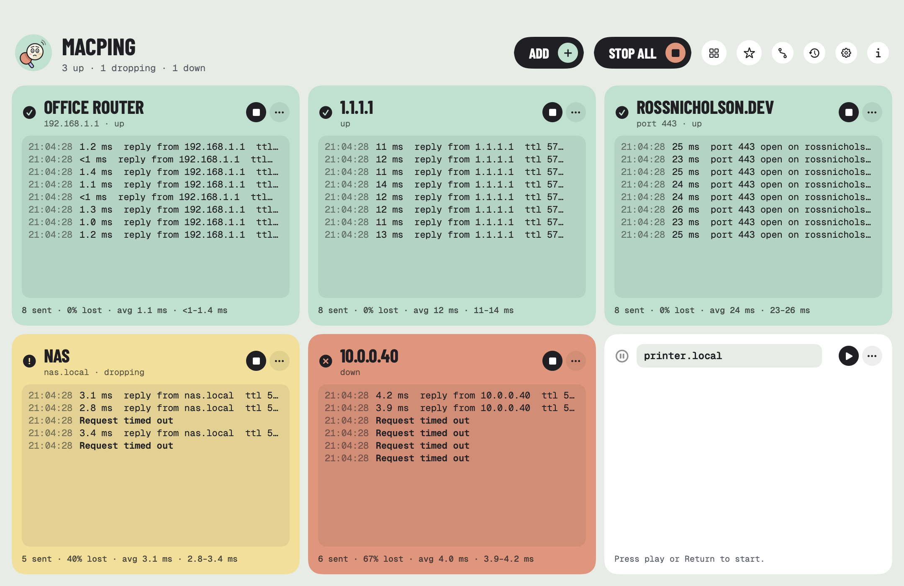
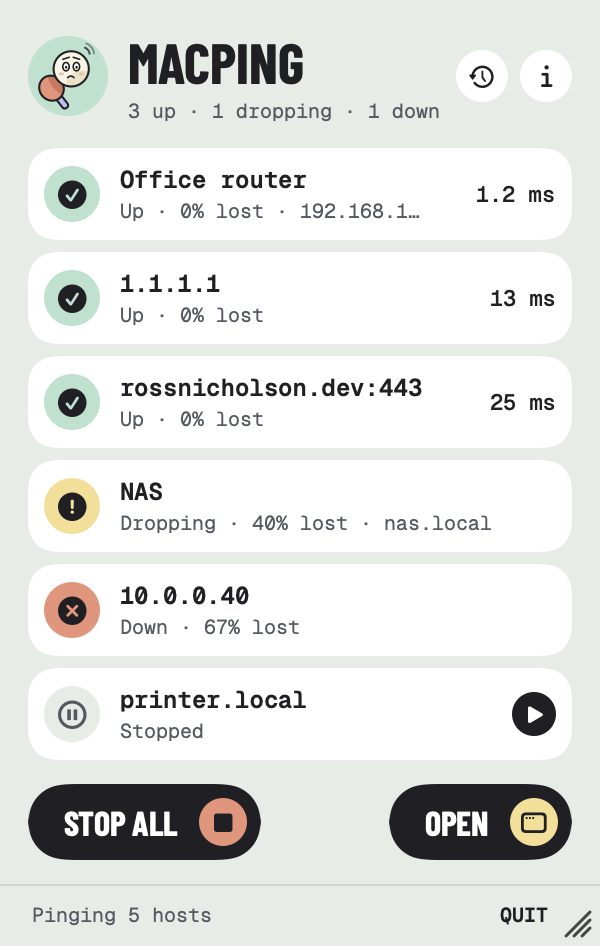
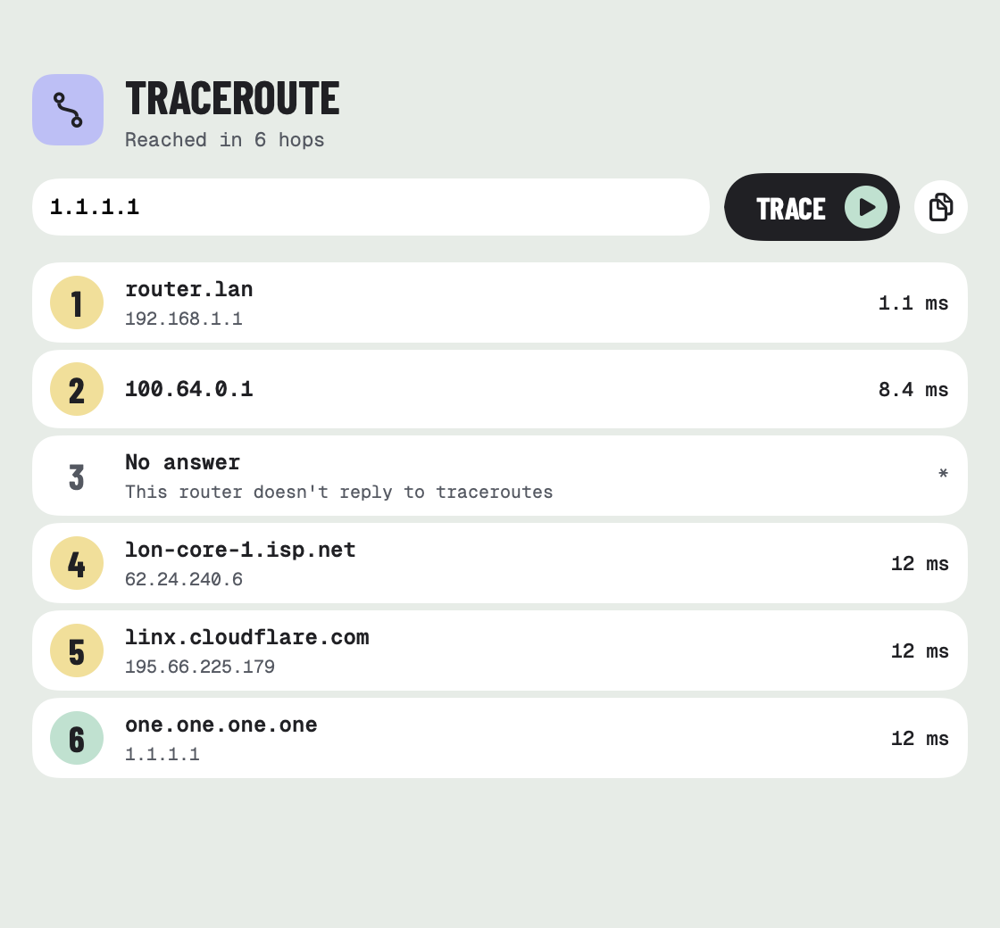

<p align="center">
  
</p>

<h1 align="center">MacPing</h1>

<p align="center">
  <strong>Ping lots of hosts at once and see which are up, at a glance.</strong><br>
  An open-source Mac app. Every host gets its own tile that turns green when it answers, yellow when replies start going missing and red when it's down, with a live log and the numbers underneath. Check TCP ports too, trace the route to a host, and keep an eye on everything from the menu bar.
</p>

<p align="center">
  <a href="https://github.com/RossNicholson/macping/releases/latest"></a>
  
  
  
  <a href="LICENSE"></a>
</p>

<p align="center">
  <picture>
    <source media="(prefers-color-scheme: dark)" srcset="docs/window-dark.png">
    
  </picture>
</p>

<p align="center">
  <a href="#install">Install</a> ·
  <a href="#features">Features</a> ·
  <a href="#how-it-pings">How it pings</a> ·
  <a href="#privacy">Privacy</a> ·
  <a href="#build-from-source">Build</a>
</p>

---

## Install

With [Homebrew](https://brew.sh):

```
brew tap RossNicholson/tap
brew trust --cask rossnicholson/tap/macping
brew install --cask macping
```

Or download the DMG from the [latest release](https://github.com/RossNicholson/macping/releases/latest). Needs macOS 14 or later. MacPing updates itself (Settings → Check for updates).

## Features

- **A tile per host.** Type a host name or IP address and press Return. Each tile shows whether the host is up, a live log of replies with their times, and how many were sent and lost, the average and the range.
- **Clear colours.** Green is up. Yellow means replies are going missing, but not enough in a row to call it down. Red is down: by default two lost in a row, and you can choose how many.
- **TCP port checks.** Type `host:port`, such as `example.com:443` or `[2001:db8::1]:22`, to check that a service is answering, not just the machine.
- **IPv4 and IPv6.**
- **Traceroute.** See every router between your Mac and a host, with names and times. Run several side by side.
- **Status history.** Every time a host goes down or comes back, filterable, and exportable as CSV, tab- or space-separated text.
- **Alerts.** A notification and a sound when a host goes down or comes back, and an optional log file with a line for each change.
- **Aliases.** Give hosts friendly names, like "Office router", to show on tiles, in alerts and in the history.
- **Favourites.** Save a set of hosts, with a column layout, and load it again in one click.
- **Lots of hosts at once.** Paste a list or drop a text file of hosts on the window. Drag tiles to reorder them, or use a tile's ⋯ menu (also on right-click) for traceroute, an alias, moving or removing it. The grid fits the window, or pick a number of columns.
- **In the menu bar.** An icon that shows how many hosts are down, and a panel listing them all. Close the window and MacPing keeps pinging up there.
- **Your way.** Ping interval, timeout, TTL and packet size, keep the window on top, open at login, and start blank, with your last hosts, or with a favourite. Hosts given on the command line are pinged straight away.

<p align="center">
  <picture>
    <source media="(prefers-color-scheme: dark)" srcset="docs/panel-dark.png">
    
  </picture>
  &nbsp;&nbsp;
  
</p>

## How it pings

MacPing sends real ICMP echo requests, like the `ping` command, using the unprivileged ICMP sockets macOS gives every app. It needs no admin password, no helper tool, and doesn't run `ping` behind the scenes. Traceroute works the same way, sending one echo request per hop with a rising TTL. Port checks open a TCP connection and close it again straight away.

## Privacy

MacPing only contacts the hosts you give it, plus GitHub to check for updates. It has no analytics or tracking, and no account. Your hosts, aliases and favourites stay in `~/Library/Application Support/MacPing`.

## Build from source

You need Xcode 26 and [XcodeGen](https://github.com/yonaskolb/XcodeGen).

```bash
git clone https://github.com/RossNicholson/macping.git
cd macping
make build   # or: make test
```

`make run` signs with the maintainer's Developer ID. To build your own copy, open the project with `xcodegen generate && open MacPing.xcodeproj` and pick your own team.

## Credits

The idea, and the set of features, come from [vmPing](https://github.com/r-smith/vmPing), a Windows app by r-smith. MacPing is a separate app written from scratch for the Mac. It uses [Barlow Condensed](https://github.com/jpt/barlow) and [Geist Mono](https://github.com/vercel/geist-font), both under the SIL Open Font Licence.

## Licence

MIT. See [LICENSE](LICENSE).
